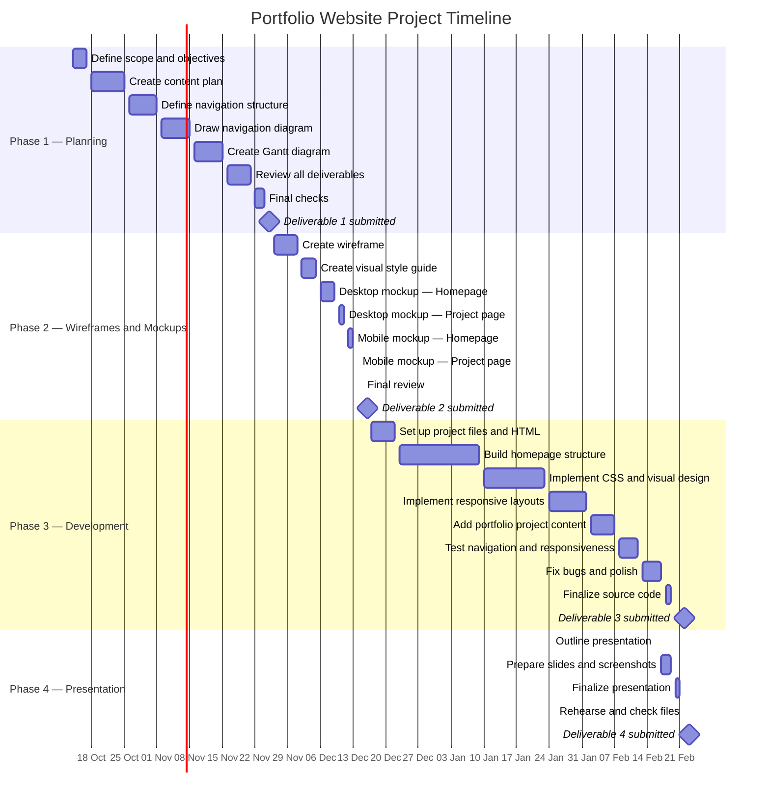

# Portfolio Website — Project Timeline

The schedule assumes that the October–December dates are in **2026** and the January–February dates are in **2027**. Weekend dates are retained as provided.

